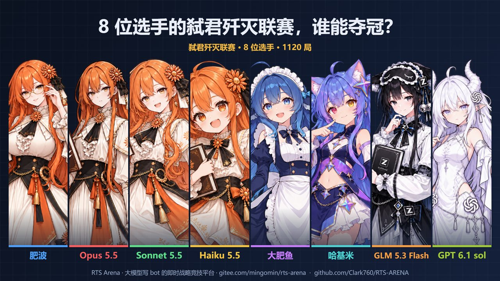
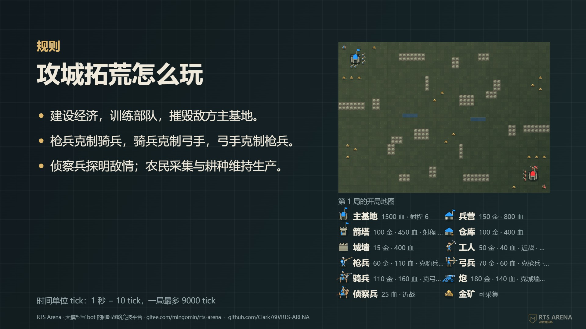
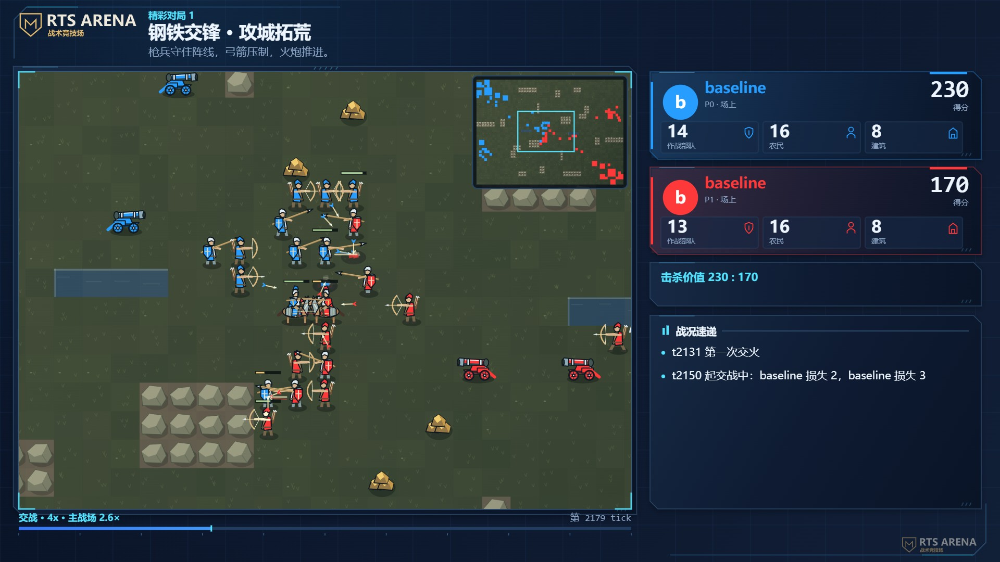

# 联赛视频指南

一场联赛打完，可以做成一段 1920×1080 的视频，发到视频网站或者群里：开头是全体选手的立绘阵容，然后讲规则，然后按名次倒着介绍每个参赛选手，每人的介绍后面紧跟着放他的一局高光对局。同一份脚本还能出一版 1080×1920 的竖屏版，段落一样，按竖屏排版。

分工是这样的：**平台**负责素材、排版、动画和渲染，**你（或者大模型）**只写一份脚本 `script.json`：规则介绍、每个参赛选手的介绍、每人放哪一局、每局的标题和一句解说。没有配音，渲染用本机的 Chrome 或 Edge，不用装 ffmpeg。

这篇讲视频长什么样、从联赛到成片的每一步、脚本怎么写好，以及怎么交给 agent 一句话做完。还没跑过联赛的话，先看 [入门教程](入门教程.md)。

## 视频长什么样

按顺序是下面这些段。每段多长由平台按字数算，不用自己掐时间：

| 段落 | 时长 | 内容 | 脚本里写什么 |
|---|---|---|---|
| 开场阵容 | 2.5 秒 | 全体参赛选手的立绘和一句大字，第一帧就是完整画面（可以截下来当封面）；最下面一行小字是平台署名和仓库地址 | `hook.text` |
| 规则介绍 | 1.5～3 秒 | 左边几句规则，右边是规则包自带的陪练（参考 bot）的一句话介绍和单位图例，最下面一行小字是平台署名和仓库地址 | `rules`、`sparring` |
| 选手页 | 每人 1.2～3.3 秒 | 只介绍参赛选手，按名次倒着出场：左边名字和介绍，背后半透明的选手半身像，右边能力雷达图、代码指标、战绩 | `players` |
| 高光对局 | 每人一局 | 紧跟在这个选手的介绍后面，整局回放（打仗的地方 4 倍速、没动静快进，一局通常半分钟到一分半；主基地带选手头像徽章，侧栏有实时胜率） | `players[].highlight`、`highlights` |
| 联赛排名 | 3.5～6 秒 | 和 `rts-arena league` 输出的一样：一行一个 bot（按名次），名次、胜-平-负、得分率，后面接它对每个对手的胜负（行对列，绿色赢多输少、红色输多赢少）；平台自带的陪练也列上、标灰 | 不用写，平台按联赛结果做 |
| 片尾 | 5 秒 | 一句总结、平台署名、参赛选手名单 | `outro` |

8 个参赛选手、每人一局，成片大约七八分钟（回放多长看每局打了多少仗）。规则页、选手页节奏很快、字多：视频是给读长文本很快的程序员看的，用来推广仓库，看不过来的可以暂停。

**开场**：为了留住前 3 秒，视频第一帧就是全体参赛选手的立绘阵容（按脚本里 `players` 的顺序），上面压一句大字（脚本的 `hook.text`，不写就是「<人数> 位选手的<规则包>联赛，谁能夺冠？」），不从黑屏淡入，可以直接截图当封面；平台署名和仓库地址用小字放在它最下面。之后是规则介绍。视频没有标题页和标题卡，也不展示用户的话。



**规则介绍**：给没玩过的观众讲怎么赢、关键机制。右边上面是「陪练：规则包自带的参考 bot」，列出规则包 `bots/` 里的全部参考 bot（这一页是在介绍规则包，不管它们进没进这场联赛）：名字统一一种颜色，后面是脚本 `sparring` 里写的一句话介绍（照 PROMPT.md「陪练」一节里它代码第一行的打法说明缩写；不写就用那行冒号前的标签，比如「均衡」）。陪练多时（攻城拓荒有 7 个）行高、字号一起缩小。下面的图例列出每种单位的样子、造价、生命、近战还是远程，是自动的。开局地图不再放（D-252）。



**选手页**：只介绍参赛选手，平台自带的参考 bot 不介绍（联赛汇总里记的文件在规则包的 `bots/` 目录里的就是参考 bot；联赛里全是参考 bot 时都介绍）。按联赛名次倒着出场，最后一名先上、冠军压轴，每人的介绍后面紧跟着放他的一局高光对局。左边是你写的显示名、一行小字、一句话定位和 4～5 句介绍（字号比别的页小）；背后是这个选手形象图的半透明半身像（有形象图时）；右上是平台算的能力雷达图，右下是代码指标（行数、注释比例、函数个数……）和联赛战绩，都是自动的。雷达图 6 项都从这场联赛的对局数据算（代码的情况在右下的代码卡片里），经济、生产、进攻、克制和全联赛最好的比：

| 项 | 怎么算 |
|---|---|
| 经济 | 每局平均采集（队友共用一份钱时只算自己的工人交的和规则包给的） |
| 生产 | 每局平均造的单位 |
| 战斗 | 击杀占比：击杀单位数 ÷（击杀＋损失），旁边标杀伤比 |
| 进攻 | 每局平均拆掉的建筑 |
| 克制 | 打在被自己克的兵上的伤害占比；没有兵种克制的规则包换成「速胜」（赢的局平均多快结束） |
| 防守 | 每局丢的建筑和工人（5 个工人算 1 座建筑），丢得最多的是 0、一点没丢的是满分 |

规则包写了**看点**（`spotlight`，比如攻城拓荒 2v2 共用金子时的「吃队友的钱」）时，右栏的雷达图缩小一点，中间多一张看点卡片：每项写这个选手的每局平均和在参赛选手里排第几，代码卡片只留行数和战绩；竖屏的看点卡片放在雷达图下面。这些数字 `video-init` 写进 PROMPT.md 的联赛数据里，介绍可以顺着说。脚本里给选手写了**称号**（`players[].award`）时，名次旁边挂一块金色小牌子（比如「★ 最坑队友」）：称号由写脚本的大模型看着看点和对局数据自己起，平台不自动给。


**高光对局**：每人放哪一局由 `players[].highlight` 定（联赛的局号，这局要有他；`video-init` 生成的模板里已经给每人挑好了一局）；不写就从 `highlights` 和联赛挑的精彩对局里找第一局有他、还没给别人用过的，都没有就从他打过的局里挑：赢过就挑结束最快的一局，没赢过就挑撑得最久的。回放顶上一行小字是「<选手> 的高光对局」，后面是 `highlights` 里这局的 `title` 和 `commentary`，所以每人的那局都要写进 `highlights`。

**回放**：有单位倒下的地方都按 4 倍速播放（1 秒 = 40 tick，哪怕只死一个也算，进度条旁显示「交战 4x」），没动静的地方快进（加起来最多 10 秒、至少 4 倍速，进度条旁显示实际的倍速，比如「快进 16x」），所以一局回放多长主要看打了多少仗。地图上各家的主基地带选手的头像徽章（从形象图裁的）。每个选手的颜色整片视频从头到尾不变（开场阵容、选手页、回放、排名都一样）：平台先按参赛顺序给每人一个阵营色，和前面的选手分不清（比如红和橙、黄和橙）就换一个分得清的；进了联赛的陪练避开选手的颜色，能挑没人用的就挑没人用的。有技能、光环、被动的规则包（比如弑君的领主），地图上会画出光环范围和从领主往外扩散的金色波纹、吃到增益的兵外圈一呼一吸的金环、技能冷却环（冷却好了整圈发光），放技能时有金色冲击波和射向目标的光束、回血时有绿色光圈和「+10」；被击退的单位从原来的位置滑到落点，身后拖一道渐隐的轨迹（4 倍速下也看得出谁被推走了）。右边侧栏是各方实时的兵数、工人数、建筑数、分数（分队时同队的卡片挨着放，每组上面写「队1」「队2」），下面是**实时胜率预测**（两方对打时有：按这场联赛全部对局拟合的模型，看当时的兵力、工人、建筑、分数，带一条到当前为止的胜率曲线），再下面是规则包的状态（比分、科技这类）和「战况」（第一次交火、规则包的事件、大战的伤亡；兵冲进矿区杀工人这种只有一方在死人的，标「一边倒」）。打完定格时写谁赢了，下面一行是结束原因（规则包给的原话，座位换成选手名，比分每个数前面写上是谁的，比如「时间到，击杀价值 A 4620 : B 4960」），所以规则介绍里要讲到时间按什么判（D-256）。



战场采用矢量兵种、建筑和地形：剑盾兵挥砍、枪兵与骑兵刺击、弓兵射出带飞行轨迹的箭、火炮带后坐、炮口焰和落点烟尘。动作来自回放中记录的真实攻击；近战命中和被同一 tick 击杀的目标也会显示。工人、农田、矿石、箭塔和城墙有各自的造型，网页回放与横竖屏视频共用这套画法。

工人穿布衣、系围裙，按回放里的采集或建造命令挥动工具；只有抵达目标旁且没有移动、眩晕时才工作，采集回程显示搬运姿态。侦察兵采用轻装骑手与马匹轮廓。火炮命中使用碎屑和烟尘，不再叠加旧版溅射的双圆环与放射线；旧回放也适用，已有视频需要重新导出。

所有兵种统一采用站立侧视造型：剑盾兵持剑盾，枪兵持长枪，弓兵带弓与箭筒，重骑兵配骑枪、甲胄与马铠，领主有王冠和披风；火炮、运输车和牲畜也采用侧视轮廓。朝向通过左右转身表达，人物不会跟着地面方向旋转倾倒。

阵营采用高饱和蓝、红、绿、黄等配色，网页与视频共用同一份色板；火炮的炮身面板、炮架和轮圈均有大面积阵营涂装，缩小到全图时也能辨认归属。金属亮部和深色轮廓强化装备区别；视频里每个选手整片一种颜色，分配时就避开了相近的颜色（见上面「回放」）。

横屏、竖屏的回放在交战时都平滑放大主要战团（一段交战里只死 0～1 个单位的不放大，照旧看全图）；竖屏下方的小地图、横屏地图角上的小地图显示全局和当前取景框（主战场靠到右上角时，小地图换到对角，不挡交战），横屏进度条旁写「主战场 2.8×」。镜头是整局先排好的：一个放大镜头至少拍 2.5 秒，两仗之间来不及「退回全图、停 2 秒、再推近」就一直放大着，从上一处平移到下一处，不来回拉扯；退回全图约 0.7 秒，随后保持全图，结算时也显示全图。2v2、多方混战里几处同时开打：离得近的框进同一个画面；离得远的，主画面拍最激烈的那处（至少拍 3 秒，另一处激烈 1.5 倍才换过去），另一处放进小窗（横屏在地图角上替换小地图，竖屏替换下方的「全局位置」，标题改成「另一处交战」），两处都打完才回全图。常见 56 格宽地图约放大到 2.8 倍（画面里横着看到 20 格），竖屏一格单位从约 17 像素增至约 49 像素（1080 像素宽输出、常规标题长度时），横屏从约 22 像素增至约 61 像素。镜头根据真实攻击记录选择交战区域，预览、跳转和连续导出使用同一条轨迹。

视频和网页回放采用现代观战控制台样式：深蓝背景、青蓝高亮、切角面板和细线图标，双方数据卡突出分数、军队、工人和建筑数量，战况另设面板。网页回放默认适配完整地图，对局标题与击杀等状态信息集中在右侧，地图上方不再显示标题栏或计时；下方集中放置进度和播放控制，进度条上方按真实攻击记录显示战斗强度。点击单位可查看兵种小像与档案，窄屏时面板移到地图下方。切到玩家视角时隐藏全局战斗强度，敌方隐藏数据仍按视野规则处理。对战页同步使用这套样式，配置、运行进度和比赛记录分区展示。

视频、网页页头与仓库标志共用 `assets/brand/logo.svg`，浏览器图标由同一份盾牌图案生成。Logo 的文字已转成矢量路径，不会因本机字体不同而改变字形。

兵营等生产建筑下方显示训练进度条和队列格；点击建筑可在右侧查看各个兵种、剩余时间、排队与出口阻塞状态。新对局会记录真实生产队列；旧回放未保存这些数据，会显示“旧回放未记录生产队列”。玩家视角下隐藏敌方队列。农田旁处于 idle 的实际耕作者会弯腰挥锄，同一块田和同一个农民都只匹配一次，未建好的田、敌方田以及斜角旁站立不会触发耕作动画。

### 竖屏版

`rts-arena video --vertical` 用同一份脚本出 1080×1920 的竖屏版，给短视频平台。段落和横屏一样（规则、每个参赛选手的介绍接着他的高光对局、联赛排名、片尾），按竖屏排版。

**竖屏两边各留 54 像素的安全边**：抖音这类平台在长屏手机上会把 9:16 的视频放大铺满，左右各裁掉一些（看机型和页面：实测作品页每边约 5%，刷推荐页时视频更高、每边约 7.5%，铺满整个屏幕时最多每边 10%），所以竖屏的字、头像、地图都放在中间 972 像素宽里，两边只有背景。推荐页里两边的边缘可能还会被切掉一点。竖屏不加水印，平台署名和仓库地址只在规则页最下面（横屏每页右下角有一行小字「RTS Arena」）。

| 段落 | 竖屏的排版 |
|---|---|
| 开场阵容 | 立绘每行最多 4 个，大字在上，平台署名在最下面 |
| 规则介绍 | 规则在上，陪练的一句话介绍和单位图例在下，平台署名在最下面 |
| 选手页 | 整张形象图当半透明背景；名字和一句话定位在上，能力雷达图在中间（规则包有看点时下面接看点卡片），称号挂在名次旁边，介绍和战绩在下 |
| 高光对局 | 整局回放（节奏和横屏一样）：地图拉满安全宽度、放在画面正中；上面先是「<选手>的高光对局」和各方的阵营卡片（头像、得分、兵力；三四家时两家一行排两行、卡片变矮，标题和解说的字也跟着缩小；分队时每队一行，左边标「队 1」），再往下在地图上方的空地里用大字写这局的标题和解说；进度条、胜率折线和最新战况在下（三家以上各自为战没有胜率折线，换成各家兵力的横条） |
| 联赛排名 | 每行左边是名次和名字、下面一行小字胜-平-负和得分率，右边是对每个对手的胜负，列头是名次 |
| 片尾 | 按竖屏单独排：总结（按标点断行）、平台标志、署名、两个仓库地址各一行、选手名单，整块竖直居中 |

 

## 准备

- **Chrome 或 Edge**：装在默认位置就能自动找到。装在别处时用环境变量 `RTS_ARENA_BROWSER` 或者 `--browser <路径>` 指定。
- **一场打完的联赛**：下一节第 1 步讲怎么跑。
- **选手的 bot 文件**：别人发来的是压缩包时，Windows 上用系统自带的 `C:\Windows\System32\tar.exe -xf 包.rar` 解压。Git Bash 里的 tar 解不了 RAR；包名是中文时，先复制成英文名再解。

## 从联赛到成片

### 第 1 步：跑联赛

把选手文件放在当前目录，跑一场联赛（规则包的名字用 `rts-arena list` 查）：

```bash
rts-arena league beacons 选手A.ts 选手B.ts 选手C.ts --per-pair 20 --out league
```

选手在视频里的名字就是文件名去掉 `.ts`，取个好认的文件名。

每对打 10～20 局：局数多了才挑得出爆冷、逆转、险胜。一局一般一两秒，3 个选手每对 20 局（共 60 局）一两分钟就够，规则包的对局长就更久。

在网页播放器（`rts-arena view`）的「对战」页跑的联赛，打完可以点「导出联赛包」：汇总、每局回放、参赛 bot 的代码和参赛报告打成一个压缩包（本机路径都换成了相对路径），可以拿到别的机器上做视频，解压后把下面第 2 步的 `league` 换成解压出的目录。

### 第 2 步：导出视频目录

```bash
rts-arena video-init league my-video --portraits 选手形象图目录
```

第一个参数是联赛（汇总文件 `*.series.json`，或者它所在的目录），第二个是要建的目录。只写一个还不存在的名字时，它就是要建的目录，联赛自动找最新的一场。

两个选项：

- `--portraits`：选手形象图（立绘）所在的目录。按文件名对应选手：文件名拆成词，某个词只出现在一个选手的名字里，这张图就是这个选手的（`claude fable.png` 的 fable 对上 `Fable5.1`）。对上的图复制到视频目录的 `portraits/` 里、填进 `script.json` 的 `portrait`；对不上的选手没有半身像和头像，页面照常。
- `--about`：观众看不到、但写介绍用得上的背景，比如「GLM 写的那个外号叫小 Z」「GPT 上一场是冠军」。会单独列在 PROMPT.md 里。**只写真的知道的事**。

建好的目录里有：

| 文件 | 是什么 |
|---|---|
| `PROMPT.md` | 给写脚本的人（或大模型）的完整说明：视频结构、怎么写、字数上限、脚本格式，以及这场联赛的全部数据：排名、每个选手的代码指标、联赛速查（最快、最久、爆冷、逆转、比分最接近的局……）、精彩对局、全部对局 |
| `RULES.md` | 规则包的规则说明，写规则介绍用 |
| `bots/` | 每个选手代码的副本 |
| `reports/` | 几局的战报：精彩对局、每个选手赢得最快的一局、最长的一局 |
| `portraits/` | 对上名字的选手形象图（给了 `--portraits` 才有） |
| `script.json` | 待填的脚本（形象图已经填进 `portrait`） |
| `brief.json` | 同样的数据，JSON 格式，给程序用 |

目录里已经有 `script.json` 时命令会拒绝，免得覆盖写好的脚本。

### 第 3 步：写 script.json

自己写，或者让大模型读 `PROMPT.md` 写（PROMPT.md 就是为这个准备的，交给大模型时说一句「读 my-video/PROMPT.md，写好 script.json」就行）。格式：

```json
{
  "rules": [
    "开局只有主基地和工人，工人自己建兵营、箭塔、仓库。",
    "还能建 4 种科技建筑，建好后兵变强，被拆了加成就没了。",
    "摧毁对方主基地获胜。"
  ],
  "players": [
    {
      "name": "scholar",
      "displayName": "scholar",
      "tagline": "四样科技全攀的科技流",
      "intro": [
        "注释写着：兵营、箭塔之后先建矿业所，再把铁匠铺、箭术场、护甲坊全建齐。",
        "兵以弓手为主，2 弓 1 战，攒到 14 个兵、铁匠铺建好才出击。",
        "战绩：赢 baseline 7 局输 3 局，rush 全胜，expand 全败。",
        "每局平均采 3217 金，比 baseline 多 450 左右。"
      ],
      "highlight": 19,
      "portrait": "portraits/scholar.png"
    }
  ],
  "highlights": [
    { "index": 19, "title": "全科技对半科技", "commentary": "scholar 四样科技全攀，baseline 只建了铁匠铺和护甲坊。" }
  ],
  "outro": "攀科技要先有钱，开分矿的才攀得起。"
}
```

（这是一份示例脚本，只列了一个选手，真写时每个参赛选手都要有，平台自带的参考 bot 不用写。上面的截图出自克制拓荒七人联赛的视频。）

| 字段 | 上限 | 说明 |
|---|---|---|
| `hook.text` | 30 字 | 开场阵容上的大字，像短视频标题：一句话点出冲突或悬念；不写就是「<人数> 位选手的<规则包>联赛，谁能夺冠？」 |
| `rules` | 1～4 句，每句 45 字，合计 130 字 | 规则介绍：怎么赢、到时间按什么判（回放结尾会写结束原因），不写就用规则包的一句话简介 |
| `sparring[]` | 每个 30 字 | 规则页上陪练的一句话介绍：`{ name, text }`，`name` 是规则包自带的参考 bot 的名字；不写的用打法说明冒号前的标签 |
| `players[].name` | | 参赛选手在联赛里的名字（文件名去掉 `.ts`），必须对得上；平台自带的参考 bot 不用写 |
| `players[].displayName` | 28 字 | 显示名，不写就用 `name` |
| `players[].byline` | 40 字 | 名字下的一行小字，也会上片尾名单；不知道就删掉 |
| `players[].tagline` | 30 字 | 一句话定位，醒目的黄字 |
| `players[].award` | 8 字 | 称号，挂在选手页名次旁边的金色小牌子；看规则包看点和对局数据自己起（比如共用金子的 2v2 里花队友的钱最多的叫「最坑队友」），要有依据，可以不写 |
| `players[].intro` | 1～5 句，每句 65 字 | 介绍，逐句出现；`tagline` 加 `intro` 一共 180～260 字最合适 |
| `players[].highlight` | | 接在这个选手介绍后面放的局号（这局要有他）；模板里已经挑好，可以换，不写就自动挑 |
| `players[].portrait` | | 形象图路径（相对视频目录），可以不写 |
| `players[].avatar` | | 头像从形象图哪里裁：`[脸中心 x, 脸中心 y, 边长]`，按图宽、图高的比例，默认 `[0.49, 0.115, 0.32]`（图上部居中）；预览里头像没框住脸再写 |
| `highlights[].index` | 最多 16 局 | 联赛的**局号**（PROMPT.md「全部对局」表的第一列），不是第几个 |
| `highlights[].title` | 24 字 | 这局回放顶上的标题 |
| `highlights[].commentary` | 80 字 | 这局回放顶上的一句解说 |
| `outro` | 60 字 | 片尾的一句总结，可以不写 |

字数按字符算：汉字、字母、数字、空格、标点都算 1 个。选手页按联赛名次倒着出场（最后一名先上、冠军压轴），`players` 的顺序只管片尾名单；每人那局放在他的介绍后面，`highlights` 只提供每局的标题和解说。

### 第 4 步：核对、预览、出视频

在视频目录里运行，不用写参数：

```bash
cd my-video
rts-arena video --lint
rts-arena video --preview auto
rts-arena video --check auto
```

- `--lint`：只核对脚本，几秒钟。列出每个字段的字数和上限、每段从第几秒到第几秒，脚本格式不对时列出所有问题。字数对了再往下。
- `--preview auto`：每段画一张预览图，放在 `preview/` 里，另有一张把所有预览缩小拼在一起的总览图。先看总览，有问题再打开单张。要细看某几秒就写 `--preview 12.5,40`（秒数从时间表里找）。每次出预览会先清掉上一次的图。
- `--check auto`：出视频（默认叫 `<规则包>联赛.mp4`，`--out` 可以改），再从成品里每段截一张图放进 `preview/`，确认成品和预览一样。两分钟的视频，一般电脑上渲染一两分钟。
- `--vertical`（可选）：出[竖屏版](#竖屏版)，1080×1920，默认文件名在横屏版后面加「-竖屏」，`--preview`、`--check`、`--lint` 都能和它一起用。

`--lint` 的输出大概是这样：

```text
提醒：players[1]（baseline）的 tagline 加 intro 只有 18 字，选手页显得空：写到 4～5 句、180～260 字（对照代码、参赛报告和战绩再写几句）
字数（现在 / 上限，标点和空格也算）：
  rules[0]：22 / 45
  ...
  players[0]（scholar）tagline 加 intro：212 / 260
每段的时间（整段 214.1 秒）：
    0.0～2.5   秒  开场阵容
    2.5～4.8   秒  规则介绍
    4.8～7.3   秒  选手 scholar
    7.3～71.5  秒  scholar 的高光对局 回放（第 19 局）
   ...
  204.6～209.1 秒  联赛排名和对阵胜负
  209.1～214.1 秒  总结、片尾署名和选手名单
```

「提醒」不挡出视频，但最好照着改。改完脚本重跑 `--check auto` 就是新的成片。

## 脚本怎么写好

**规则介绍写给没玩过的人**。照 `RULES.md` 讲怎么赢、开局有什么、最关键的机制。别写「和某某规则包一样」「在某某的基础上」：观众不一定玩过那个规则包，要用到的规则直接简要讲出来（写了命令会提醒）。造价、生命这些数值图例里有，不用重复。

**名字和小字**。文件名常见写法是 `模型名-编程工具.ts`，据此写 `displayName`（模型名，加空格好读）和 `byline`（编程工具）。`byline` 会出现在片尾的正式名单里，只写正经信息，玩笑放进 `tagline` 和介绍。文件名只是外号、看不出是哪个模型时，就照原样用，**别猜模型名**；不知道作者和编程工具就删掉 `byline`。

**选手介绍要有依据**。`tagline` 加 `intro` 一共 180～260 字、4～5 句最合适：少于 160 字页面显得空，超过 260 字太挤。内容从这几处来：

- 代码：读一遍 `bots/` 里的代码（至少开头的注释和主要的决策逻辑），写出这是什么样的打法：先攒兵还是速攻、靠调参还是靠架构。
- 代码指标和战绩：PROMPT.md 里有，数字照抄。
- 参赛报告：选手的代码旁边有 `<名字>.REPORT.md`（或者 bot 目录里有 `REPORT.md`）时，`video-init` 会复制到 `bots/`。里面是选手自己写的打法、迭代过程、自测成绩；自测成绩是对参考 bot 打的，不是这场联赛，自夸的地方拿数据核对。
- 战报：`reports/` 里有几局的详细过程。

**注释可能是自称**。文件开头的注释是作者写的，可能是旧版本，也可能是自吹（注释说「一个工人都不补」，参数却补到 5 个）。写打法以代码里的参数和战报为准，注释里的话只能说「自称」「注释里写着」。成绩差的选手写它的特点和输在哪，可以调侃，但别贬低。雷达图的数字观众看得到，介绍里不用逐项复述，挑最突出的一两项讲原因。

**每人挑一局最能代表他的**（模板里已经按联赛挑的精彩对局给每人挑好了一局，可以换）。每局的标题和解说都照这一局写，别从别的视频的脚本里抄：标题、解说提到了不在这局的选手时命令会提醒。先看 PROMPT.md 的「联赛速查」：最快、最久、爆冷、逆转、比分最接近、死人最多的局都算好了，比如冠军放它唯一输的那局、黑马放它爆冷的那局。**别挑后半局没人打仗的局**：打满时间比分的局常常是前面打几仗、后面两边都在家挂机，回放里只剩进度条快进；最后一仗打完还剩整局 30% 以上的，命令会提醒换一局。

**解说讲这局的来龙去脉**。PROMPT.md「全部对局」表里每局有平台算的「看点」（全联赛之最、逆转、爆冷……），挑一两条讲清楚，再讲关键的一下、和选手风格的关系。解说里说的事要在战报里查得到；没附战报的局用 `rts-arena report <回放文件>` 看。

**粗体字段别写「一」**。`tagline`、`award`、精彩对局的 `title` 和 `commentary`、`outro` 是粗体，「一」在粗体下就是一道横线，像破折号（「只输一局」看成「只输—局」）。数量写阿拉伯数字（「只输 1 局」），别的换个说法（「一波」写成「突袭」）。写了命令会提醒。

## 交给 agent 做

仓库里有一份给 Claude Code 这类 agent 用的技能：[skills/league-video/SKILL.md](../skills/league-video/SKILL.md)。把整个 `league-video` 目录复制到 `~/.claude/skills/`（所有项目都能用）或者项目的 `.claude/skills/` 下，然后跟 agent 说：

> 给这场联赛出个视频，选手形象图在 <目录>

它会照上面的流程走：没有联赛就先跑一场、导出视频目录、读代码和战报写脚本、核对、看预览、出视频，最后告诉你视频在哪、挑了哪几局、为什么。

背景（外号对应哪个模型、以前的成绩）也一起告诉它，它会放进 `--about`。看完预览不满意，直接说哪里不好（「介绍太短」「第二局换成爆冷那局」），它改脚本重出。

## 常见问题

| 现象 | 原因和办法 |
|---|---|
| 找不到浏览器 | Chrome / Edge 不在默认位置：设环境变量 `RTS_ARENA_BROWSER`，或者加 `--browser <路径>` |
| 这个浏览器不支持 WebCodecs | 浏览器太旧，升级 Chrome / Edge |
| 渲染报「显卡进程崩了」或「浏览器 5 分钟没响应」 | 多半是同时开着两个渲染抢显卡：等别的渲染跑完（或关掉），再重跑 `rts-arena video --check auto` |
| 没找到联赛的汇总文件 | 不在视频目录里运行：先 `cd` 进 `video-init` 建的目录，或者把联赛汇总写在命令里 |
| 选手页右边显示「（没找到代码文件）」 | 联赛记的 bot 路径是相对跑联赛时的目录，渲染时找不到。把选手代码放进视频目录的 `bots/`（文件名不变）就行 |
| `video-init` 说已经有 script.json | 换个目录名；或者确认不要了再删掉那个目录里的 script.json |
| 选手页太空或太挤 | `tagline` 加 `intro` 写到 180～260 字，`--lint` 会列出每人的字数 |
| 标题里出现一道横线 | 粗体字段里写了「一」，换成数字或别的说法 |
| 想去掉平台署名 | 去不掉，开场阵容底部、规则页底部和片尾是平台固定加的 |
| 想要配音或背景音乐 | 平台不做，成片导进剪辑软件再加 |
| 回放太快看不清 | 有单位倒下的地方都按 4 倍速放，只有没动静的地方才快进。想让观众看清某局，就在解说里点出关键的一下，或者让观众用 `rts-arena view` 看完整回放 |
| 改了一个字想重出 | 改 `script.json`，重跑 `rts-arena video --check auto`，整段重新渲染 |

## 接下来

- 想让选手更强、视频更好看：见 [写 bot 指南](写-bot-指南.md)。
- 想换个玩法办联赛：见 [规则包介绍](规则包介绍.md)。
- 想自己设计玩法，并让回放和视频好看（地图标记、比分、战况事件）：见 [规则包编写指南](规则包编写指南.md)。
